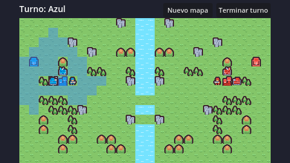

# Frontline Tactics

Juego de estrategia por turnos para Android, inspirado en Advanced Wars. Hecho en **Godot 4.3**.



## Cómo abrirlo

1. Descargar Godot 4.3 (versión estándar, no la .NET): https://godotengine.org/download/archive/4.3-stable/
2. Abrir Godot → **Importar** → escoger el archivo `project.godot` de esta carpeta.
3. Presionar **F5** (o el botón ▶) para jugar. En el PC el clic del mouse funciona como el toque del celular.

## Cómo se juega (por ahora)

- Toca una unidad azul: se resaltan en azul las casillas a donde puede moverse.
- Toca una casilla resaltada: la unidad se mueve y queda gris (ya actuó).
- Toca una unidad roja: se ve en rojo hasta dónde puede llegar.
- **Terminar turno**: juega la máquina (rojo) y luego vuelve tu turno.
- **Nuevo mapa** (temporal): genera otro mapa aleatorio.

### Terreno

| Terreno | Infantería | Tanque / Artillería | Defensa |
|---|---|---|---|
| Llanura, ciudad, base, cuartel | 1 | 1 | 0 a 3 |
| Bosque | 2 | No puede | 2 |
| Montaña | 2 | No puede | 3 |
| Agua | No puede | No puede | — |

El número es cuántos puntos de movimiento gasta entrar a esa casilla.

## Estructura

```
scenes/main.tscn        Escena principal (mapa + HUD)
scripts/datos.gd        Datos de terrenos y unidades (precios, vida, movimiento...)
scripts/game_map.gd     Mapa, edificios y dueños, posiciones de las unidades y cálculo de movimiento
scripts/generador_mapa.gd  Mapas aleatorios simétricos (26×15) con ciudades
scripts/unidad.gd       Una unidad: tipo, equipo, vida, si ya se movió
scripts/resaltado.gd    Dibuja las casillas resaltadas y el cursor
scripts/main.gd         Toques en pantalla, selección y movimiento
scripts/ia.gd           IA del enemigo
tests/                  Prueba automática del movimiento
assets/kenney_tiny_battle/  Gráficos de Kenney.nl (licencia CC0)
```

- **Cambiar el tamaño o la cantidad de ciudades, bosques, etc.:** editar `scripts/generador_mapa.gd`.
- **Repetir un mapa:** la consola de Godot muestra la semilla de cada mapa; `nuevo_mapa(semilla)` lo vuelve a generar.
- **Cambiar valores de las unidades:** editar `UNIDADES` en `scripts/datos.gd`.

## Estado y tareas

| Parte | Responsable | Estado |
|---|---|---|
| Mapa de cuadrícula y terrenos | Persona 2 | ✅ Listo |
| Mapas aleatorios con ciudades | Persona 2 | ✅ Listo |
| Selección y movimiento táctil | Persona 2 | ✅ Listo |
| IA del enemigo | Persona 2 | 🟡 Base lista (falta compra de unidades) |
| Turnos, combate, créditos y victoria | Persona 1 | ⏳ Pendiente |
| Menús, HUD, sonido y exportar APK | Persona 3 | ⏳ Pendiente |

### Para la persona 1 (reglas)
- `main.gd` emite la señal `unidad_movida(unidad)` cuando una unidad termina de moverse: ahí va el menú *Atacar / Esperar*.
- `Datos.LE_GANA_A` ya tiene el piedra, papel o tijera; `rango_min` y `rango_max` de cada unidad dicen desde qué distancia ataca.
- `mapa.distancia(a, b)`, `mapa.unidades_de(equipo)` y `mapa.eliminar_unidad(u)` sirven para el combate.
- **Créditos:** `mapa.ingreso_de(equipo)` dice cuánto gana un equipo por turno (1000 por cada edificio suyo, se cambia en `Datos.INGRESO_POR_EDIFICIO`).
- **Capturar ciudades:** `mapa.cambiar_dueno(celda, equipo)` cambia el dueño y el color del edificio. La IA ya manda su infantería hacia las ciudades; falta la acción de capturar.
- `mapa.buscar_edificio("base", "azul")` da la casilla donde aparecen las unidades compradas; para crearlas: `mapa.crear_unidad(tipo, equipo, celda)`.
- La IA emite `ataque_elegido(atacante, objetivo)` cuando decide atacar (ya se movió a la casilla): conectarla a la función de combate, por ejemplo `ia.ataque_elegido.connect(atacar)`.
- `terminar_turno()` en `main.gd` es temporal: reemplazarlo por el sistema de turnos real.

### Para la persona 3 (visual)
- El HUD está en el nodo `HUD` de `main.tscn`. El juego se dibuja a 480×270 y se escala a la pantalla.
- Para exportar: Proyecto → Exportar → Android (hay que instalar las plantillas de exportación y configurar el SDK de Android).

## Prueba automática

```
godot --headless --path . --script res://tests/prueba_movimiento.gd
godot --headless --path . --script res://tests/prueba_ia.gd
godot --headless --path . --script res://tests/prueba_generador.gd
```

## Créditos

Gráficos: [Tiny Battle](https://kenney.nl/assets/tiny-battle) de Kenney.nl (CC0).
